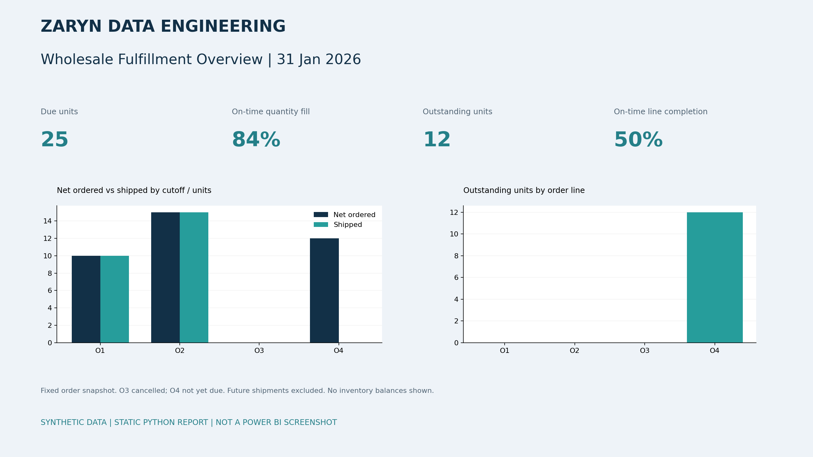

# Zaryn | Wholesale Fulfillment Dashboard



Static Python-rendered portfolio report using synthetic data, not a Power BI screenshot or client deployment. The PNG is generated by the reporting workflow; the image link becomes available after that workflow completes successfully.

## Reporting Snapshot

The committed CSV summarizes the supplied orders and shipments as of 2026-01-31: 25 due units, 21 filled on time (84%), 12 outstanding units across all lines, and one of two eligible lines complete on time (50%). O3 is cancelled. O4 is not yet due and its February shipment is excluded. Outstanding quantity is not inventory on hand.

`dashboard_data.csv` is a fixed reporting snapshot. The renderer reads this file, not the live pipeline or source systems. If source data changes, regenerate and validate the snapshot before rendering; that refresh is not automated here.

## Reproduce

From the repository root:

```bash
python -m pip install matplotlib==3.9.4
python reporting.py
```

This replaces `reports/dashboard.png`. The CSV and report code contain no customer data.

## GitHub Rendering

The Build dashboard workflow runs on changes to the renderer, snapshot CSV, or workflow, and can also be run manually from Actions. It runs the existing tests, renders the PNG, then commits only `reports/dashboard.png` using repository contents-write permission. Branch rules or Actions policy may prevent that commit; in that case generate locally and upload the PNG. No Azure resources are provisioned.
